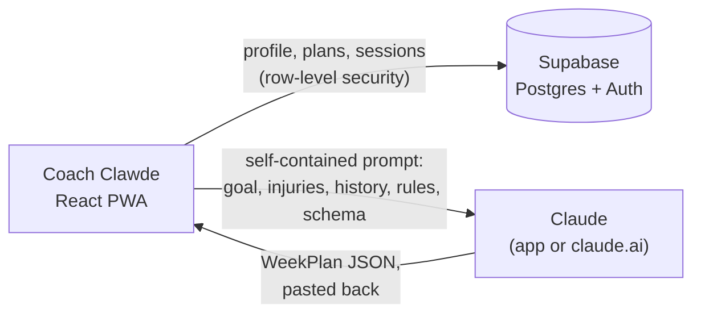

<p align="center">
  
</p>

<h1 align="center">Coach Clawde</h1>

<p align="center">
  <b>Plans your week. Runs your sessions. Learns from both.</b><br>
  A training app that writes next week's plan around your goal, your free days and your injuries,<br>
  then coaches you through every set, rep and interval.
</p>

<p align="center">
  <a href="https://n473cl0.github.io/coach-clawde/">Website</a> ·
  <a href="https://coach-clawde.vercel.app">Open the app</a> ·
  <a href="docs/DEPLOYMENT.md">Run your own</a>
</p>

<p align="center">
  <a href="https://github.com/n473CL0/coach-clawde/actions/workflows/ci.yml"></a>
  
</p>

<p align="center">
  
  
  
  
  
</p>

> **Invite-only beta.** Accounts are created by hand, so there's no sign-up form. Screenshots show demo data.

## What it does

- **Onboarding is a chat.** Clawde asks what you're training for (a race, a habit, a holiday, your sport, or a plan you already follow), then your time, kit and a quick health screen. Ten questions at most, every one of which changes the plan.
- **One tap plans the week.** The app builds a self-contained prompt from your goal, injuries, working weights and recent sessions, and opens it in Claude. Paste the JSON reply back and the week is set: dated sessions, warm-ups, cool-downs and progressive overload.
- **Lifting, logged as you go.** Tick through the warm-up, log reps and weight per set, and the rest timer starts itself. Every exercise has a movement guide.
- **Run Mode times every rep.** Audio cues for go, recover and "change coming", a LAP button for distance reps, pace zones from a recent race time, and a log that fills itself in.
- **Weekly check-ins.** A one-minute chat at the end of the week. Every answer (shorter sessions, a lighter week, a sore knee) changes the next plan.
- **Progress.** Block progress, a four-week grid, personal bests for every lift and a full history.
- **Installable and offline-ready** as a PWA, with sync across devices.

## How it works

There's no AI call on a server. The app writes the prompt, the athlete sends it to Claude, and the reply comes back as typed JSON that the app validates and imports.



- **Onboarding** is a deterministic flow, not an LLM chat: a goal tree (`src/lib/flow.ts`, `src/lib/goalFlow.ts`) whose tests enforce at most 10 questions on every path.
- **The prompt** (`src/lib/promptBuilder.ts`) is tailored per athlete: a gym-only lifter's prompt never mentions cardio, and home equipment is a hard rule. History is summarised to keep it focused (`src/lib/historySummary.ts`).
- **Coaching numbers** (pace zones from VDOT, tapers, deloads, minimum block lengths) live in one file, `src/lib/coachingConfig.ts`.
- **Data** is per user in Supabase with owner-only RLS policies (`supabase/migrations/`). With no Supabase variables set, the app runs in an offline single-user "local mode".

## Tech stack

React 19, TypeScript, Vite, Tailwind CSS v4, Zustand, React Router, `vite-plugin-pwa`, Supabase (Postgres, Auth, RLS), Vitest. Deployed on Vercel. The website in [`site/`](site/) is plain HTML and CSS on GitHub Pages.

## Getting started

```bash
npm install
npm run dev      # local dev; runs in offline "local mode" without Supabase env vars
npm run lint     # ESLint, must pass clean
npm test         # Vitest unit tests for the logic in src/lib
npm run build    # tsc -b && vite build (the typecheck gate)
```

To sign in locally, copy `.env.example` to `.env.local` and add your Supabase keys. [`docs/DEPLOYMENT.md`](docs/DEPLOYMENT.md) covers a full deployment, from the database schema to creating beta accounts, and [`docs/DEVELOPING.md`](docs/DEVELOPING.md) has the file map and conventions.

## Project structure

```
src/
  pages/          one component per screen (Home, WeekPlanner, Session, Progress…)
  components/     session UI (sets, rest timer, Run Mode), onboarding chat, shared primitives
  lib/            pure logic: prompt builder, goal tree, check-ins, pace zones, workouts (unit-tested)
  store/          Zustand stores, persisted locally as the offline cache
supabase/         SQL migrations (schema + row-level security)
scripts/          operator scripts: create beta accounts, check setup, generate icons
site/             the GitHub Pages website
docs/             deployment, development and device-fit notes
CLAUDE.md         programming rules and the WeekPlan schema, for generating plans with Claude Code
```

## Credits

- Exercise photos and instructions in the movement guides come from [free-exercise-db](https://github.com/yuhonas/free-exercise-db).
- Icons from [Lucide](https://lucide.dev). Website fonts: Doto, Geist and Space Mono (SIL Open Font License).
- Clawde the crab is a nod to the Claude Code mascot, now in a sweatband.

## Disclaimer

Coach Clawde is general fitness guidance, not medical advice. It's an independent project and isn't affiliated with or endorsed by Anthropic. Claude is a trademark of Anthropic, PBC.

---

Built by [@n473CL0](https://github.com/n473CL0).
