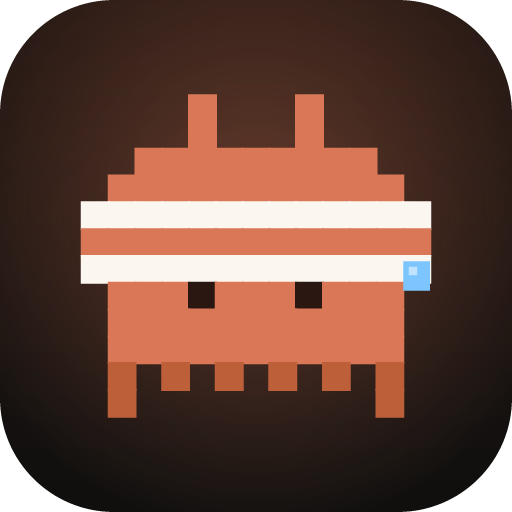
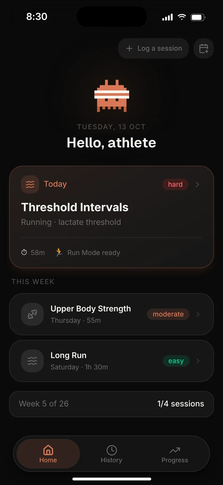
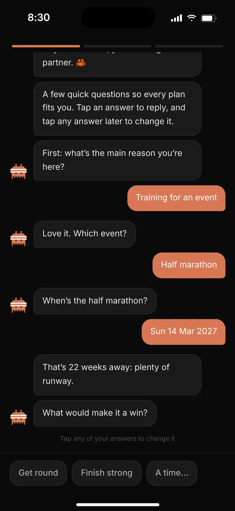
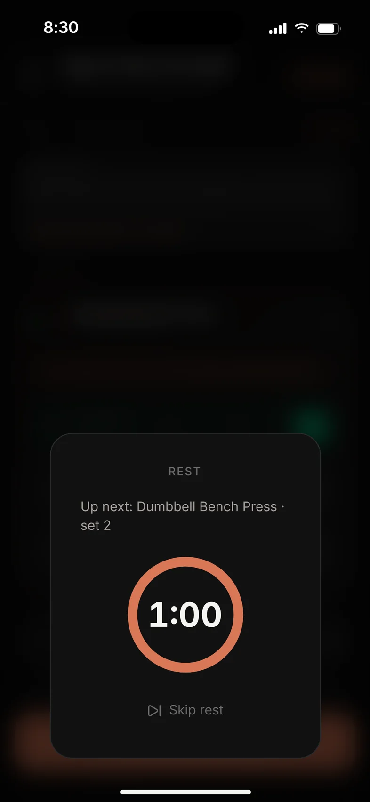
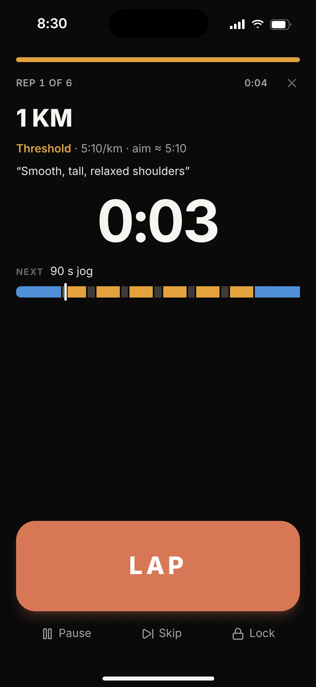
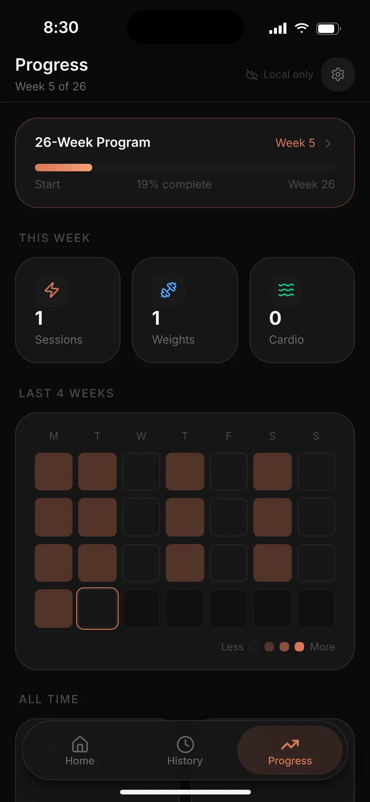
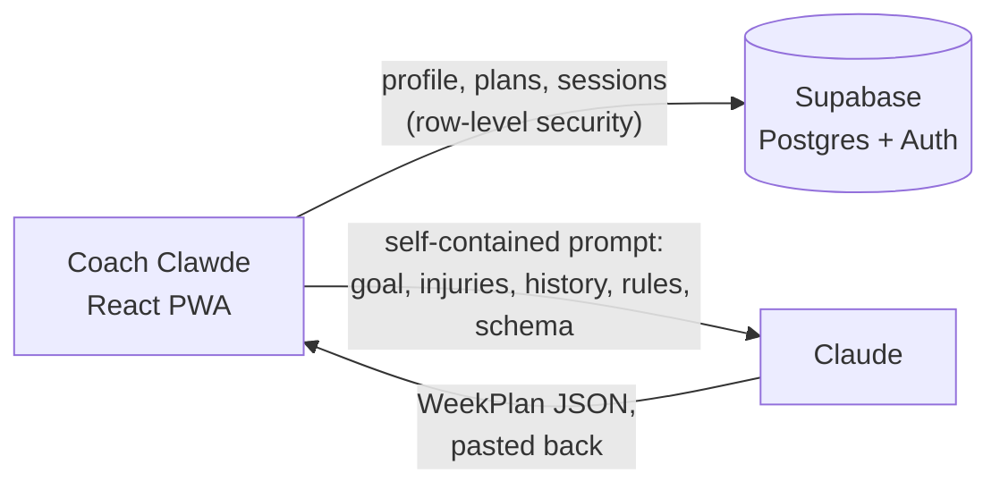

<p align="center">
  
</p>

<h1 align="center">Coach Clawde</h1>

<p align="center">
  <b>Plans your week. Runs your sessions. Learns from both.</b><br>
  A training app that writes next week's plan around your goal, your free days and your injuries,<br>
  then coaches you through every set, rep and interval.
</p>

<p align="center">
  <a href="https://n473cl0.github.io/coachclawde/">Website</a> ·
  <a href="https://coachclawde.vercel.app">Open the app</a> ·
  <a href="docs/DEPLOYMENT.md">Run your own</a>
</p>

<p align="center">
  <a href="https://github.com/n473CL0/coachclawde/actions/workflows/ci.yml"></a>
  
</p>

<p align="center">
  
  
  
  
  
</p>

> **Invite-only beta:** accounts are created by hand, so there's no sign-up. Screenshots show demo data.

## What it does

- **Chat onboarding.** Clawde asks what you're training for (a race, fitness, physique, strength, a sport, or your own plan), then your time, kit and health. Ten questions at most.
- **One-tap weekly plans.** The app builds a prompt from your goal, injuries, working weights and recent sessions and opens it in Claude. Paste the JSON back and the week is set, with warm-ups, cool-downs and progressive overload.
- **Guided lifting.** Log reps and weight per set; the rest timer starts itself and every exercise has a movement guide.
- **Run Mode.** Audio cues for every rep, a LAP button for distance work, pace zones from a recent race time, and a log that fills itself in.
- **Weekly check-ins** feed straight into the next plan: shorter sessions, a lighter week, a sore knee.
- **Progress and PRs** across the block, plus full history. Installable PWA, offline-ready, synced across devices.

## How it works

No server-side AI. The app writes the prompt, you send it to Claude, and the reply comes back as typed JSON the app validates and imports.



| Piece | Where |
|---|---|
| Onboarding goal tree (deterministic; tests cap every path at 10 questions) | `src/lib/flow.ts`, `src/lib/goalFlow.ts` |
| Per-athlete prompt (only the rules and kit that apply) | `src/lib/promptBuilder.ts`, `src/lib/historySummary.ts` |
| Coaching numbers: VDOT pace zones, tapers, deloads | `src/lib/coachingConfig.ts` |
| Per-user data with owner-only RLS | `supabase/migrations/` |

Without Supabase env vars the app runs in an offline single-user "local mode".

**Stack:** React 19, TypeScript, Vite, Tailwind CSS v4, Zustand, Supabase, Vitest, on Vercel. The [website](site/) is plain HTML/CSS on GitHub Pages.

## Run it locally

```bash
npm install
npm run dev
```

`npm run lint`, `npm test` and `npm run build` are the CI gates. To sign in, copy `.env.example` to `.env.local` with your Supabase keys. See [`docs/DEPLOYMENT.md`](docs/DEPLOYMENT.md) for a full deployment and [`docs/DEVELOPING.md`](docs/DEVELOPING.md) for the file map and conventions. [`CLAUDE.md`](CLAUDE.md) holds the programming rules and `WeekPlan` schema for generating plans with Claude Code.

## Credits

- Movement-guide photos and instructions: [free-exercise-db](https://github.com/yuhonas/free-exercise-db).
- Icons: [Lucide](https://lucide.dev). Fonts: Tiny5, Geist, Space Mono (SIL OFL).
- Clawde is a nod to the Claude Code mascot, now in a sweatband.

## Disclaimer

General fitness guidance, not medical advice. An independent project, not affiliated with or endorsed by Anthropic. Claude is a trademark of Anthropic, PBC.

---

Built by [@n473CL0](https://github.com/n473CL0).
